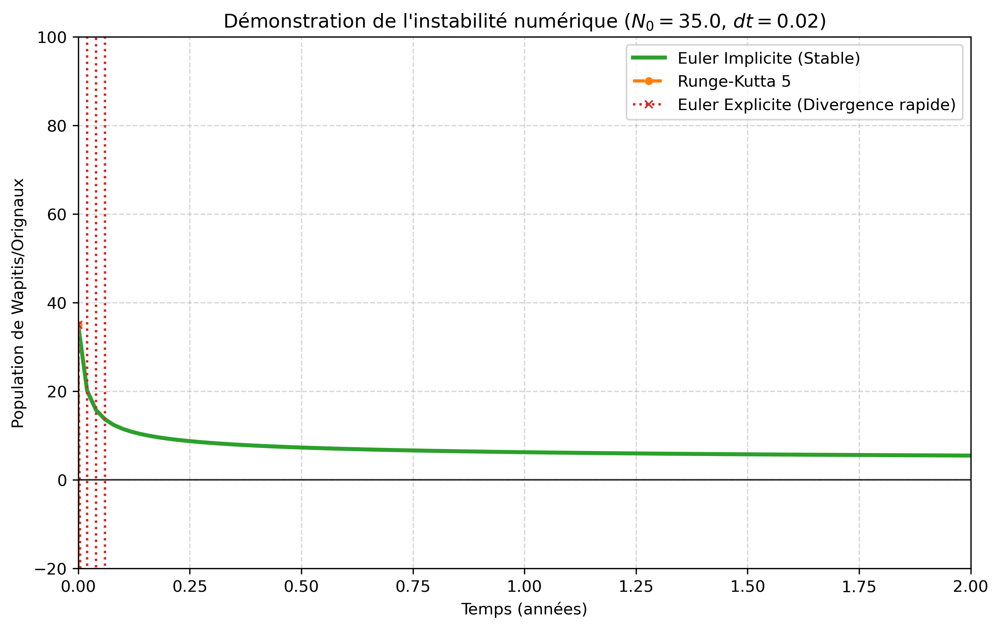
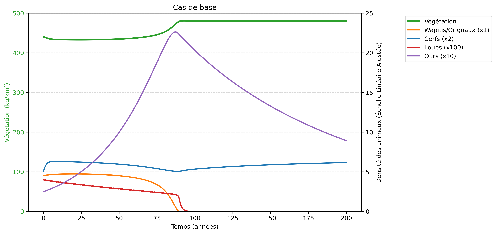
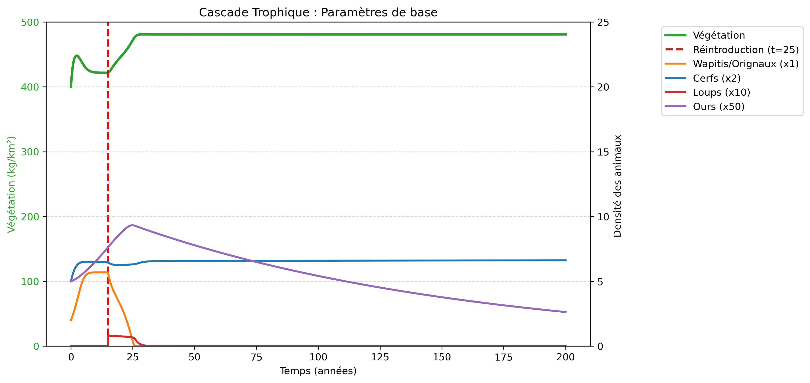
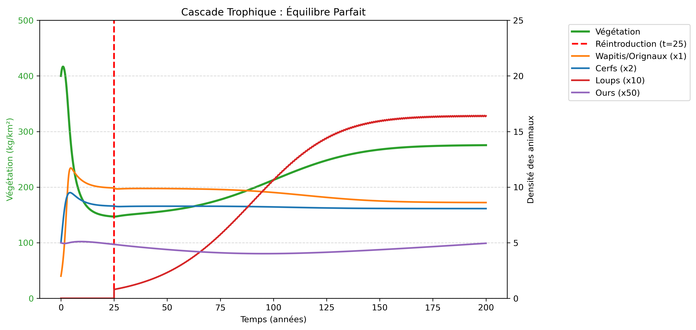

# 🐺 Étude d'une Cascade Trophique

Modélisation mathématique et simulation numérique d'une **cascade trophique à cinq niveaux d'interaction** : **Végétation ($V$)**, **Wapitis/Orignaux ($N$)**, **Cerfs ($D$)**, **Loups ($W$)** et **Ours ($B$)**.

Ce projet étudie la dynamique spatiale d'un écosystème complexe régi par un système d'équations différentielles ordinaires (EDO) non linéaires et **raides** (*stiff*), en comparant plusieurs solveurs numériques implémentés de zéro en Python.

---

## 📖 Contexte et Modèle Mathématique

Afin de pouvoir étendre la modélisation à n'importe quelle taille de réserve naturelle, le modèle considère la **densité spatiale** des populations :
- **Animaux ($N, D, W, B$)** : nombre d'individus par $\text{km}^2$.
- **Biomasse végétale ($V$)** : kilogrammes par $\text{km}^2$ ($\text{kg/km}^2$).

### Système d'Équations Différentielles (EDO)

Le système dépasse le modèle classique de Lotka-Volterra pour intégrer des comportements écologiques réalistes (croissance $\theta$-logistique dépendante de la ressource, réponses fonctionnelles de Holling, prédation dépendante du ratio, omnivorie et chasse saisonnière) :

$$\frac{dV}{dt} = \underbrace{r_V V \left(1 - \frac{V}{K_V}\right)}_{\text{Croissance logistique}} - \underbrace{\frac{\alpha_N V N}{\nu_N + V}}_{\text{Pâturage wapitis}} - \underbrace{\frac{\alpha_D V D}{\nu_D + V}}_{\text{Pâturage cerfs}} - \underbrace{\frac{\alpha_B V B}{\nu_B + V}}_{\text{Alimentation ours}}$$

$$\frac{dN}{dt} = \underbrace{r_N N \left[1 - \left(\frac{N}{\kappa_N(V)}\right)^{\theta_N}\right]}_{\text{Croissance }\theta\text{-logistique}} - \underbrace{\frac{c_{WN} N W}{W + \beta N}}_{\text{Prédation loups}} - \underbrace{\frac{c_{BN} N B}{h_{BN} + N}}_{\text{Prédation ours}} - \underbrace{\delta_N N}_{\text{Mortalité de fond}}$$

$$\frac{dD}{dt} = \underbrace{r_D D \left[1 - \left(\frac{D}{\kappa_D(V)}\right)^{\theta_D}\right]}_{\text{Croissance }\theta\text{-logistique}} - \underbrace{\frac{c_{WD} D W}{h_{WD} + D}}_{\text{Prédation loups}} - \underbrace{\frac{c_{BD} D B}{h_{BD} + D}}_{\text{Prédation ours}} - \underbrace{\delta_D D}_{\text{Mortalité de fond}}$$

$$\frac{dW}{dt} = \underbrace{\left[\epsilon_1 \ln(\Phi_W + \eta) - \epsilon_2\right] W}_{\text{Réponse numérique non linéaire}} - \underbrace{m_W W}_{\text{Mortalité naturelle}} - \underbrace{\mu_W \sin^2(\pi t) W}_{\text{Prélèvement humain saisonnier}}$$

$$\frac{dB}{dt} = \left[\underbrace{e_B \left(\frac{c_{BN} N}{h_{BN} + N} + \frac{c_{BD} D}{h_{BD} + D}\right)}_{\text{Gain énergétique (proies)}} + \underbrace{\frac{e_V \alpha_B V}{\nu_B + V}}_{\text{Gain énergétique (flore)}} - \underbrace{m_B}_{\text{Mortalité}}\right] B$$

Avec les capacités de charge dynamiques et la disponibilité en proies :
$$\kappa_N(V) = K_N \frac{V}{V^* + V}, \qquad \kappa_D(V) = K_D \frac{V}{V^{**} + V}, \qquad \Phi_W = \frac{c_{WN} N}{W + \beta N} + \frac{c_{WD} D}{h_{WD} + D}$$

**Conditions initiales de base ($t = 0$) :**
$$U_0 = (V_0, N_0, D_0, W_0, B_0)^T = (440.0,\ 4.5,\ 2.5,\ 0.04,\ 0.25)^T$$

---

## 🧮 Méthodes Numériques Implémentées

Le script `code_projet.py` implémente et compare quatre approches pour résoudre le système d'EDO :

1. **Euler Implicite « Maison » (`resolv_systeme_maison`)** :
   - Formulation implicite : $y_{n+1} = y_n + dt \cdot f(t_{n+1}, y_{n+1})$, ramenée à la recherche de racine $G(X) = X - y_n - dt \cdot f(t_{n+1}, X) = 0$.
   - Résolution non linéaire à chaque pas de temps via la **méthode de Newton-Raphson** (`solveurMaison`).
   - Approximation numérique de la **matrice Jacobienne** par différences finies (`Jacobien`).
   - Inversion du système linéaire $J_G(X^{(k)}) \Delta X = G(X^{(k)})$ par **décomposition $PA = LU$ avec pivot partiel** (`decomposition_PA_LU`, `descente`, `remontee`, `resoudre_PA_LU`).
2. **Euler Implicite via SciPy (`resolv_systeme`)** :
   - Utilisation de `scipy.optimize.fsolve` à titre de référence de performance et de précision.
3. **Euler Explicite (`eulerexplicite`)** :
   - Schéma direct d'ordre 1 : $y_{n+1} = y_n + dt \cdot f(t_n, y_n)$.
4. **Runge-Kutta d'ordre 5 à 6 étapes (`rungekutta5`)** :
   - Schéma explicite d'ordre supérieur basé sur le tableau de Butcher à 6 évaluations intermédiaires ($k_1$ à $k_6$).

---

## ⚖️ Raideur du Système et Stabilité Numérique

Le modèle écologique étudié est un **système raide** (*stiff*) : il fait coexister des dynamiques très rapides (chute brutale d'une population sous forte prédation, chasse saisonnière) et des dynamiques lentes (renouvellement végétal et démographique sur plusieurs décennies).

Bien que plus coûteuse par itération (résolution d'un système linéaire à chaque pas), la méthode d'**Euler Implicite** est **inconditionnellement stable**, contrairement aux méthodes explicites :

- Pour un choc initial modéré ($N_0 = 23.0, dt = 0.02$), **Euler Explicite** plonge immédiatement dans des valeurs négatives non physiques, tandis que **Runge-Kutta 5** parvient encore à amortir le choc.
- Pour une forte surpopulation initiale ($N_0 = 35.0, dt = 0.02$), **Euler Explicite** et **Runge-Kutta 5** divergent totalement, alors qu'**Euler Implicite** amortit naturellement la pente abrupte et converge de manière lisse vers l'équilibre.



---

## 📊 Résultats des Simulations Écologiques

### 1. Cas de base sur 200 ans ($dt = 0.05$)

Avec les paramètres initiaux du modèle, l'écosystème s'avère déséquilibré et évolue en trois phases :
1. **Explosion des ours (0 à 80 ans)** : Omnivores et sans prédateur naturel, les ours profitent à la fois de l'abondante végétation et des deux espèces d'ongulés.
2. **Déclin des loups et effondrement des wapitis (80 à 100 ans)** : Affaiblis par la chasse saisonnière ($\mu_W = 0.10$) et la mortalité naturelle, les loups déclinent. La surpopulation d'ours exerce une prédation insoutenable sur les wapitis ($r_N = 0.30$), provoquant leur extinction vers $t = 85$ ans, ce qui entraîne dans la foulée l'extinction définitive des loups (compétition interspécifique).
3. **Nouvel équilibre appauvri (100 à 200 ans)** : Sans les wapitis ($\alpha_N = 15.0$), la végétation sature à sa capacité maximale ($K_V = 500\text{ kg/km}^2$). Les cerfs survivent grâce à leur taux de reproduction plus élevé ($r_D = 0.50$) et les ours déclinent lentement vers un seuil plus bas.



---

### 2. Cascade Trophique : Réintroduction des loups (Paramètres de base)

En partant d'un milieu sans loups ($W_0 = 0$) puis en réintroduisant une meute ($W = 0.08$) avec les paramètres de base, le taux de mise à mort très élevé sur les wapitis ($c_{WN} = 7.5$) face à leur faible croissance ($r_N = 0.30$) simule un milieu insulaire fermé sans zone de refuge (analogue à *Isle Royale*). Les loups surexploitent les wapitis jusqu'à l'extinction, causant leur propre disparition et la saturation de la végétation.



---

### 3. Cascade Trophique : Équilibre Écologique Parfait

Pour obtenir une cascade trophique stable après la réintroduction des loups à $t = 25$ ans, les paramètres biologiques ont été ajustés afin de modéliser un milieu ouvert avec zones de refuge, auto-régulation de la meute et réduction de la chasse humaine :

| Paramètre | Description | Valeur de base | Valeur ajustée (Équilibre) |
| :--- | :--- | :---: | :---: |
| `r_V` | Taux de croissance intrinsèque de la végétation | `1.20` | `1.00` |
| `alpha_N` | Intensité de pâturage des wapitis/orignaux | `15.0` | `20.0` |
| `r_N` | Taux de croissance intrinsèque des wapitis | `0.30` | `0.60` |
| `K_N` | Capacité de charge maximale des wapitis | `7.0` | `15.0` |
| `r_D` | Taux de croissance intrinsèque des cerfs | `0.50` | `0.60` |
| `K_D` | Capacité de charge maximale des cerfs | `4.0` | `6.0` |
| `c_WN` | Coefficient de mise à mort loup-wapiti | `7.5` | `2.0` |
| `c_WD` | Coefficient de mise à mort loup-cerf | `2.0` | `0.5` |
| `beta` | Interférence mutuelle des loups en chasse | `0.5` | `0.8` |
| `epsilon_2` | Seuil métabolique de la réponse numérique des loups | `0.5` | `0.1` |
| `m_W` | Mortalité naturelle des loups | `0.15` | `0.10` |
| `mu_W` | Amplitude du prélèvement humain saisonnier | `0.10` | `0.03` |
| `m_B` | Mortalité naturelle des ours | `0.08` | `0.11` |

Dans cette configuration, la réintroduction des loups à $t = 25$ ans régule efficacement les populations d'ongulés sans les anéantir, stoppe le surpâturage et stabilise la végétation autour de $275\text{ kg/km}^2$, permettant la coexistence durable des 5 niveaux trophiques.



---

## 📂 Structure du Dépôt

```text
cascade_trophique/
├── code_projet.py                                   # Script principal (modèle EDO, solveurs, simulations et tracés)
├── rapport_DUBURCQ_ROUTHIER_RIDEAU.pdf              # Rapport complet de l'étude mathématique et écologique
├── comparaison_stabilites_lisible_2.png             # Graphique de stabilité (Euler Implicite vs RK5 vs Explicite)
├── simulation_200_ans.png                           # Graphique de la simulation du cas de base sur 200 ans
├── parametres_de_base_reintroduction_des_loups.png  # Graphique de réintroduction des loups (paramètres initiaux)
├── equilibre_stable_reintroduction_des_loups.png    # Graphique de réintroduction des loups (équilibre stable)
└── README.md                                        # Documentation du projet
```

---

## 🚀 Installation et Utilisation

### 1. Cloner le dépôt

```bash
git clone [https://github.com/jamesduburcq/cascade_trophique.git](https://github.com/jamesduburcq/cascade_trophique.git)
cd cascade_trophique
```

### 2. Installer les dépendances Python

Le projet nécessite **Python 3** ainsi que les bibliothèques `numpy`, `scipy` et `matplotlib` :

```bash
pip install numpy scipy matplotlib
```

### 3. Lancer les simulations

Vous pouvez exécuter l'intégralité du script ou lancer les cellules séquentiellement (`#%%`) dans un environnement comme **Spyder** ou **VS Code** :

```bash
python code_projet.py
```

---

## 👥 Auteurs

Projet réalisé en **Avril 2026** par :
- **James Duburcq** — [@jamesduburcq](https://github.com/jamesduburcq)
- **Raphaël Rideau**
- **Orion Routhier**
